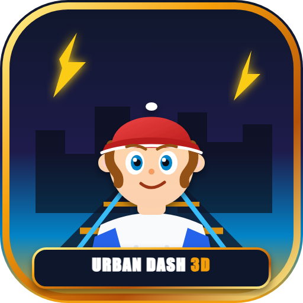

# ⚡ NEON VELOCITY: Cyberpunk 3D Runner

An ultra-responsive, 60FPS mobile-first 3D perspective cyberpunk arcade runner built with pure HTML5 Canvas, Web Audio API procedural sound synthesis, and Progressive Web App (PWA) architecture.



---

## 🎮 Game Features

- **Mobile-First Touch Controls**: Smooth one-finger swipe & drag steering, plus optional on-screen arcade buttons.
- **Synthesizer Audio Engine**: 100% procedural 80s synthwave bassline, retro drums, arpeggios, and sound effects built directly into the Web Audio API (zero audio files needed, works instantly with zero loading delay).
- **Overdrive Hyperspeed Mode**: Collect energy orbs or perform risky near-misses to fill your Overdrive meter, triggering invincibility and smashing through barriers!
- **Cyber Garage & Progression**:
  - 4 Unique Cyber-Crafts: *Specter-01*, *Apex Phantom*, *Viper X*, and *Titan Dreadnought*.
  - 4 Upgradable Systems: Magnet Engine, Shield Capacitor, Overdrive Booster, and Credit Multiplier.
  - 5 Neon Plasma Trail Colors: Cyan, Magenta, Lime, Gold, Violet.
  - Persistent save of high scores, credits, and unlocked ships via `localStorage`.
- **Progressive Web App (PWA)**:
  - Add to Home Screen on iPhone (iOS) and Android to play in full-screen just like a native app.
  - Offline support via Service Worker caching.

---

## 🚀 How to Host Live for 100% Free on GitHub Pages

You can host this game permanently and completely free so you (and anyone in the world) can open it on your phone:

### Step 1: Create a GitHub Repository
1. Log in to [GitHub.com](https://github.com).
2. Click **New Repository** (or visit [github.com/new](https://github.com/new)).
3. Name it: `neon-velocity` (or any name you prefer).
4. Set it to **Public**.
5. Leave "Add a README file" unchecked and click **Create repository**.

### Step 2: Push this Project to Your Repository
In your terminal / PowerShell inside this folder, run:

```bash
git add .
git commit -m "Initial commit of Neon Velocity game"
git branch -M main
git remote add origin https://github.com/<YOUR_GITHUB_USERNAME>/neon-velocity.git
git push -u origin main
```

*(Replace `<YOUR_GITHUB_USERNAME>` with your actual GitHub username)*

### Step 3: Turn on GitHub Pages (1-Click)
1. On your GitHub repository page, click **Settings** (top tab).
2. In the left sidebar, click **Pages**.
3. Under **Build and deployment** > **Branch**:
   - Change `None` to **`main`** (or `master`)
   - Leave the folder as `/(root)`
   - Click **Save**.
4. In about 30 seconds, GitHub will give you your free live URL:
   ```
   https://<YOUR_GITHUB_USERNAME>.github.io/neon-velocity/
   ```

---

## 📱 How to Open and Install on Your Phone

1. **Open the live link** on your mobile browser (Safari on iPhone, Chrome on Android).
2. **Install as a Phone App**:
   - **iPhone (Safari)**: Tap the **Share icon** (square with up arrow) at the bottom -> Scroll down -> Tap **"Add to Home Screen"** -> Tap **Add**.
   - **Android (Chrome)**: Tap the **3-dots menu** in top right -> Tap **"Install app"** or **"Add to Home screen"**.
3. You will now have the **Neon Velocity** icon directly on your phone's home screen! Tap it anytime to launch directly in immersive full-screen without address bars or browser frames.

---

## 🕹️ Controls

| Control | Action |
| :--- | :--- |
| **Touch Drag / Swipe** | Glide ship left and right across lanes |
| **Virtual Buttons (◀ / ▶)** | Step steer left / right |
| **BOOST Button / Spacebar** | Activate Overdrive Mode (when charged) |
| **Keyboard Left / Right (A / D)** | Steer left / right |
| **Pause (⏸ / P / Esc)** | Pause game and view menu |
